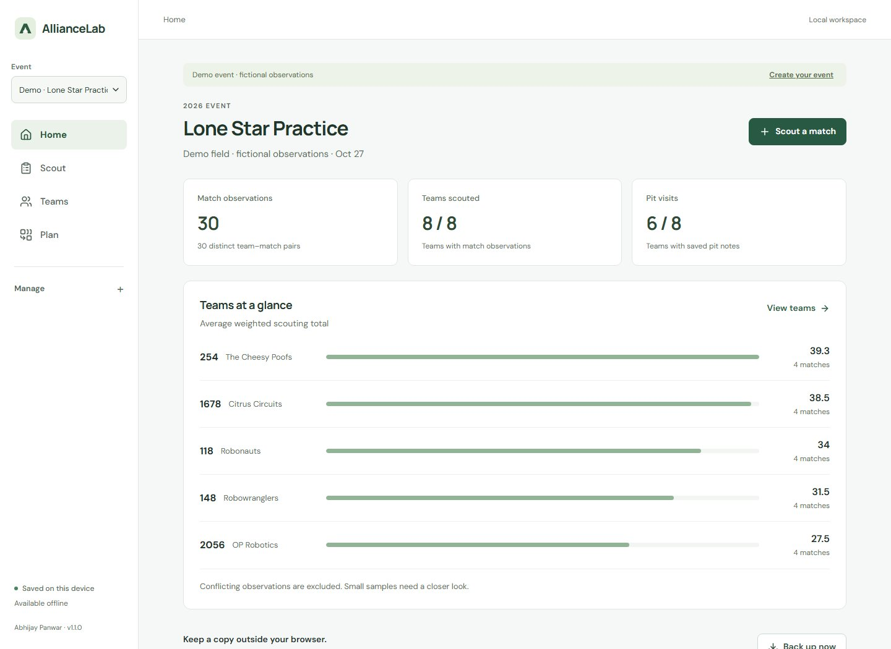
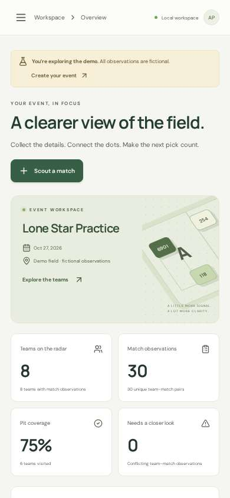

<p align="center"></p>
<h1 align="center">AllianceLab</h1>
<p align="center"><strong>Offline scouting. Clearer alliance decisions.</strong></p>
<p align="center">An independent FRC scouting workspace by <a href="https://github.com/linux-cmd">Abhijay Panwar</a>.</p>
<p align="center"><a href="../../actions/workflows/check-release.yml"></a> <a href="LICENSE"></a> <a href="../../releases"></a></p>

**[Open AllianceLab](https://alliancelab.vercel.app)** · [Download v1.0.0](https://github.com/linux-cmd/alliancelab/releases/tag/v1.0.0)

AllianceLab helps scouts capture match and pit observations, compare teams, and prepare an alliance pick list. It runs in your browser, keeps data on your device, and works offline after its first successful load.



<details><summary>See the phone layout</summary><p></p></details>

## What you can do

- **Set up your own season.** Create an event, paste a team roster, and define count, yes/no, or rating metrics across auto, teleop, and endgame.
- **Scout from the stands.** Use touch-friendly counters, persistent match drafts, scout names, alliance colors, defense ratings, and notes.
- **Keep a pit notebook.** Record drivetrain, weight, autonomous capabilities, strengths, and questions for the drive team.
- **Compare the evidence.** Inspect team averages, match variation, reliability, sample sizes, pit notes, and match-by-match performance.
- **Build a working alliance.** Adjust priorities, try two three-team combinations, and mark teams unavailable.
- **Share without a server.** Export JSON backups, import with a preview, transfer observations through multipart QR codes, scan QR images, or export match CSV.
- **Stay usable offline.** The production build caches every screen, bundled font, and required asset. No external font service, API key, login, or database is required.

The demo event is separate and clearly labeled. It uses real team names with **entirely fictional observations**.

## Quick start

Use Node.js **22.23+** or Node.js 24 and npm.

```sh
git clone https://github.com/linux-cmd/alliancelab.git
cd alliancelab
npm ci
npm run dev
```

Open the address printed by Vite. Choose **Explore the demo** to look around, or **Create event** to start with your own roster.

For the production app and offline installation:

```sh
npm run build
npm run preview
```

The service worker is generated during the production build. Offline caching is intentionally disabled in the development server. Serve `dist/` from HTTPS, or use localhost for development. Opening `index.html` directly from disk is unsupported.

## First event, in five minutes

1. Create an event and paste one team per line: `6901, Knights Robotics`.
2. Choose your metrics and value weights. The defaults are practice examples, not any season’s official scoring rules.
3. Set your scout name in Event settings, then save match and pit observations.
4. Open Teams & insights to compare up to four teams. Review small samples and conflicting observations.
5. Use Alliance lab to adjust pick-list priorities. Export a JSON backup at the end of each scouting session.

Share the event setup with the crew before scouting. JSON or QR transfers preserve the event and observation IDs used to merge data correctly.

## How the numbers work

A match’s **weighted scouting total** is the sum of its observed metrics multiplied by the event’s value weights. The average and standard deviation use distinct, undisputed team–match pairs. These totals are estimates for comparison, **not official scores**.

If multiple scouts observe the same team in the same match, they do not inflate the match count. Matching observations count once. Conflicting values, disable statuses, or defense ratings flag that pair for review and exclude it from estimates. Edit or delete the incorrect record in the observation log to resolve it.

The **pick score** normalizes each team’s metric average against the best observed average in the event, applies your priorities, and scales the weighted result to 100. Reliability and defense can also contribute. It is a relative ranking, not a win probability. Combined alliance totals add individual averages; they do not simulate congestion, autonomous collisions, or game rules.

Read the full [data and scoring guide](docs/DATA_MODEL.md).

## Data, backups, and privacy

All scouting data stays in this browser’s localStorage. The app does not operate a scouting backend or collect analytics. Camera frames are processed on the device.

Browser storage can be cleared or run out of space. Keep a JSON backup outside the browser. Backups contain saved event definitions and observations; match drafts, preferences, and planner selections stay on the originating device. Data is not encrypted. Anyone with access to your browser profile or backup can read scout names and notes.

Opening the workspace in another tab pauses saving in the original tab to prevent silent overwrites. Download any unsaved work before reloading the latest copy. JSON imports are validated and previewed; repeated record IDs are skipped or updated only when the incoming revision is newer.

More: [Privacy](PRIVACY.md) · [Security](SECURITY.md) · [Deployment](docs/DEPLOYMENT.md)

## Development checks

```sh
npm run check
npx playwright install --with-deps chromium
npm run test:e2e
```

The browser suite exercises desktop and phone layouts, scouting and editing, offline reloads, lazy screens, backup imports, QR frame reconstruction and image scanning, pit notes, planner persistence, accessibility checks, recovery, and concurrent tabs.

See [architecture](docs/ARCHITECTURE.md), [contributing](CONTRIBUTING.md), and the [changelog](CHANGELOG.md).

## v1 boundaries

- No live FIRST event API, accounts, cloud synchronization, Bluetooth transfer, or automated scouting.
- Qualification match numbers are supported. Use a separate event for other match formats.
- Metric definitions are fixed once an event has match observations. Create a new event to change the schema.
- Events with the same name but different IDs remain separate; distribute one event setup to scouts before collecting data.
- Defense rating 0 means “not observed” and contributes zero to the current average. Review notes before drawing a conclusion from that value.
- QR checksums detect damage, not the sender’s identity. A file transfer is more practical for large datasets.
- Local storage capacity varies by browser. The schema bounds imports to 100 events, 500 teams per event, 50,000 match observations, and 10,000 pit observations; device storage may be exhausted earlier.

## License and attribution

MIT © 2026 **Abhijay Panwar**. Bundled DM Sans and Manrope fonts use the SIL Open Font License; see [third-party notices](THIRD_PARTY_NOTICES.md).

AllianceLab is an independent community project. It is not affiliated with or endorsed by FIRST. FIRST and FRC are trademarks of FIRST.
